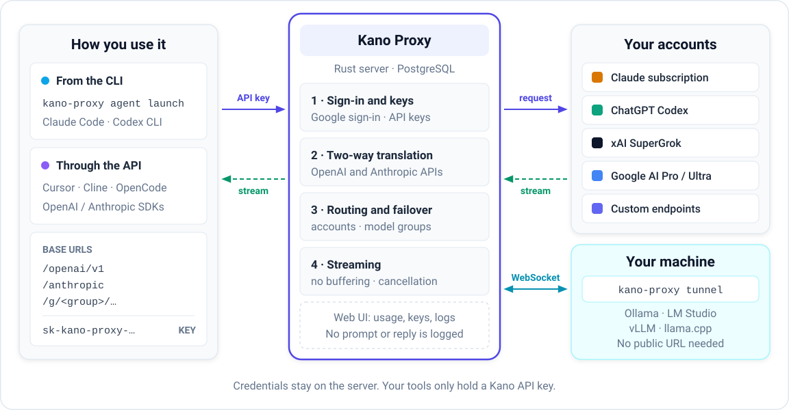

# Kano Proxy

<p align="center">
  <strong>One OpenAI- and Anthropic-compatible endpoint for the AI accounts you connect.</strong>
</p>

<p align="center">
  <a href="./README.md">English</a> · <a href="./README.zh-TW.md">繁體中文</a>
</p>

<p align="center">
  
  
  
  
</p>

> [!WARNING]
> **Unofficial project. Read before use.**
>
> - Kano Proxy is not affiliated with or endorsed by Anthropic, OpenAI, Google or xAI.
> - To use a subscription account, it signs in and sends requests the way the provider's own CLI does. This may break that provider's terms, and providers have restricted or banned accounts used this way.
> - Connect only accounts you hold. Most providers forbid sharing an account or reselling access. You are responsible for following each provider's terms.
> - Provided as is, without warranty, under the MIT License. Details: [Risks and terms](./apps/docs/pages/guide/risks.md).

---

**Kano Proxy** puts the AI accounts you already have behind one endpoint. Connect your subscriptions (Claude, ChatGPT Codex, SuperGrok, Google AI Pro/Ultra), your own OpenAI- or Anthropic-compatible endpoints, or a model running on your laptop. Then use any of them from a coding agent or from your own code, through the standard OpenAI and Anthropic APIs.

It is one Rust server and a PostgreSQL database, run with docker compose on a machine you control. Your provider credentials stay on the server. Your tools only ever hold a Kano API key.

## Get started

1. Sign in with Google at [kano-proxy.yuufeng.com](https://kano-proxy.yuufeng.com), the hosted version, or at your own server (see [Self-hosting](#self-hosting)). The first sign-in asks you to accept the notice above.
2. Open **Providers** and connect at least one account.

Then pick how you want to use it:

- **[Use it from the CLI](#use-it-from-the-cli)**: run Claude Code or the Codex CLI on your proxy with one command.
- **[Call the API](#call-the-api)**: any OpenAI or Anthropic client, SDK or `curl`.

## Use it from the CLI

Install the `kano-proxy` CLI:

```bash
brew install yufeng-kano/tap/kano-proxy
# or
curl -fsSL https://raw.githubusercontent.com/yufeng-kano/kano-proxy/main/scripts/install-cli.sh | sh
```

On Windows: `scoop bucket add kano https://github.com/yufeng-kano/scoop-bucket`, then `scoop install kano-proxy`.

Sign this machine in, once:

```bash
kano-proxy login                                    # the hosted instance
kano-proxy login --base-url https://<your-domain>   # your own server
```

Start a coding agent on your proxy. The agent itself must be installed; `claude-code` needs a Claude account connected, `codex` needs a ChatGPT account:

```bash
kano-proxy agent launch claude-code
kano-proxy agent launch codex
```

The agent runs on your proxy for this session, its own config is left alone, and the key the CLI creates for it is revoked when the agent exits. Anything after `--` goes to the agent:

```bash
kano-proxy agent launch codex -- exec "run the tests"
```

To make it permanent, let the CLI set the agent up instead. From then on, starting the agent the usual way goes through the proxy:

```bash
kano-proxy agent setup claude-code     # asks which models to use, then writes the agent's config
kano-proxy agent restore claude-code   # undoes it exactly
```

### Use a model on your own machine

Ollama, LM Studio, vLLM or llama.cpp on your laptop can be a provider too. The CLI connects out to the proxy, so you need no public URL and no port forwarding:

```bash
kano-proxy tunnel add      # asks for a name (its slug), the format and the local URL, e.g. http://localhost:11434/v1
kano-proxy tunnel start    # keep this running while you use it
```

Its models then answer as `<slug>/<model>`, with the slug you chose, like any other provider.

More: [Install and sign in](./apps/docs/pages/cli/install.md) · [Set up and launch agents](./apps/docs/pages/cli/agents.md) · [Local models](./apps/docs/pages/cli/local-models.md)

## Call the API

1. Open **Access** and create a key. It starts with `sk-kano-proxy-` and is shown once.
2. Pick a model id on **Models**. Ids look like `provider/model`.
3. Send a request to either base URL.

| API | Base URL |
|---|---|
| OpenAI-compatible (Chat Completions, Responses) | `https://<your-domain>/openai/v1` |
| Anthropic Messages (the client adds `/v1/messages`) | `https://<your-domain>/anthropic` |

```bash
curl https://<your-domain>/openai/v1/chat/completions \
  -H "Authorization: Bearer <your-api-key>" \
  -H "Content-Type: application/json" \
  -d '{
    "model": "claude-code/claude-opus-5",
    "messages": [{"role": "user", "content": "Say hello in five words."}],
    "max_tokens": 32
  }'
```

The same key and model id work on the Anthropic base, whichever provider the model comes from. The proxy converts the request and the response:

```bash
curl https://<your-domain>/anthropic/v1/messages \
  -H "x-api-key: <your-api-key>" \
  -H "anthropic-version: 2023-06-01" \
  -H "Content-Type: application/json" \
  -d '{
    "model": "claude-code/claude-opus-5",
    "max_tokens": 32,
    "messages": [{"role": "user", "content": "Say hello in five words."}]
  }'
```

Example ids (your own list is on **Models**):

| Provider | Example id |
|---|---|
| Claude Code | `claude-code/claude-opus-5` |
| ChatGPT Codex | `codex/gpt-5.6-sol` |
| xAI Grok | `grok/grok-4.5` |
| Google Antigravity | `antigravity/gemini-3-flash` |
| A custom endpoint or local model | `<slug>/<model>`, with the slug you gave it |

Any tool or SDK that takes a base URL and an API key works the same way, including Aider and the OpenAI and Anthropic SDKs. Setup pages: [Cursor](./apps/docs/pages/agents/cursor.md) · [Cline](./apps/docs/pages/agents/cline.md) · [OpenCode](./apps/docs/pages/agents/opencode.md)

More: [Endpoints and model ids](./apps/docs/pages/reference/endpoints.md) · [Routing and failover](./apps/docs/pages/reference/routing.md) · [Errors](./apps/docs/pages/reference/errors.md)

## What it does

- **Any model in any tool.** GPT and Gemini inside Claude Code, Claude and Grok inside Cursor or the Codex CLI. Chat Completions, the Responses API and Anthropic Messages are translated both ways.
- **Failover.** Put several accounts behind a subscription provider, or several providers and endpoints behind a model group. When one is rate-limited, out of quota, signed out or not answering, the request moves to the next.
- **Model groups.** Give a tool the model names it expects, such as `claude-opus-5`, and choose which providers answer each name, in order. Each group has its own base URL: `/g/<slug>/openai/v1` and `/g/<slug>/anthropic`.
- **Usage and spend limits.** See each account's 5-hour and weekly quota and the estimated cost of every request. Give any API key a daily, weekly or monthly limit in USD.
- **Private by default.** Prompts and completions are never written to the logs or the database.
- **Built for coding agents.** Streaming without buffering, cancellation, tool calling, vision, audio input, reasoning effort and Anthropic prompt caching.

<p align="center">
  
</p>

## What you can connect

| Provider | What it uses |
|---|---|
| Claude Code | A Claude Pro, Max, Ultra or Team subscription |
| ChatGPT Codex | A ChatGPT Plus, Team or Pro subscription |
| xAI Grok | A SuperGrok subscription |
| Google Antigravity | Google AI Pro or Ultra |
| Custom endpoints | Any OpenAI- or Anthropic-compatible API: a base URL and a key |
| Local models | Ollama, LM Studio, vLLM or llama.cpp on your machine, through the CLI |

Each subscription provider can hold several accounts, tried in the order you set. To fall back across providers, custom endpoints or local models, use a model group.

## Self-hosting

Four containers, one job each: PostgreSQL, the API server, the web app (the admin UI and the public `/docs/` site), and Caddy for TLS and routing.

```bash
git clone https://github.com/yufeng-kano/kano-proxy.git
cd kano-proxy
cp .env.example .env     # fill it in: domain, ACME email, Google OAuth client, secrets
docker compose up -d --build
```

Point your domain's DNS at the machine and open ports 80 and 443. Caddy fetches a certificate on the first request, and the server applies its migrations at start. If you already run a reverse proxy, drop the `caddy` service and route the API paths yourself, as [the deployment doc](./docs/deployment.md) describes.

To work on the code, see [Testing](./docs/testing.md). Each app under `apps/` builds and tests on its own.

## Documentation

- [Getting started](./apps/docs/pages/guide/getting-started.md)
- [Risks and terms](./apps/docs/pages/guide/risks.md)
- [The CLI](./docs/cli.md)
- [API and protocol mapping](./docs/api.md)
- [Providers, routing and failover](./docs/providers.md)
- [Deployment](./docs/deployment.md)
- [Everything else](./docs/index.md)

## License

[MIT](./LICENSE)
