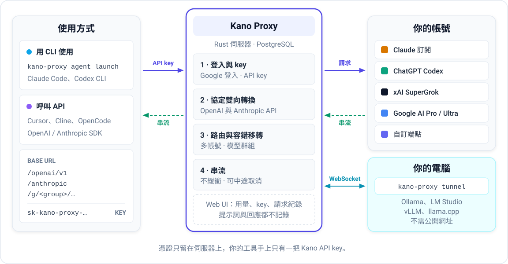

# Kano Proxy

<p align="center">
  <strong>把你連接的 AI 帳號，整合成一個相容 OpenAI 與 Anthropic 的端點。</strong>
</p>

<p align="center">
  <a href="./README.md">English</a> · <a href="./README.zh-TW.md">繁體中文</a>
</p>

<p align="center">
  
  
  
  
</p>

> [!WARNING]
> **非官方專案，使用前請先閱讀。**
>
> - Kano Proxy 與 Anthropic、OpenAI、Google、xAI 沒有關係，也沒有獲得它們背書。
> - 為了使用訂閱帳號，它會照各家官方 CLI 的方式登入和送出請求。這可能違反該供應商的條款，也已經有供應商限制或封鎖這樣使用的帳號。
> - 只連接你自己持有的帳號。多數供應商禁止分享帳號或轉售存取權。遵守各家條款是你的責任。
> - 本軟體依 MIT 授權、依現狀提供，不附任何保證。詳見[風險與條款](./apps/docs/pages/zh-TW/guide/risks.md)。

---

**Kano Proxy** 把你已經有的 AI 帳號集中到一個端點後面。連接你的訂閱（Claude、ChatGPT Codex、SuperGrok、Google AI Pro/Ultra）、你自己的 OpenAI 或 Anthropic 相容端點，或是你電腦上跑的模型，之後就能透過標準的 OpenAI 與 Anthropic API，在 coding agent 或自己的程式裡使用其中任何一個。

它是一個 Rust 伺服器加一個 PostgreSQL 資料庫，用 docker compose 跑在你自己掌控的機器上。供應商的憑證只留在伺服器上，你的工具手上只有一把 Kano API key。

## 開始使用

1. 用 Google 登入託管版 [kano-proxy.yuufeng.com](https://kano-proxy.yuufeng.com)，或你自架的伺服器（見[自架](#自架)）。第一次登入會請你同意上面的使用說明。
2. 打開 **Providers**，至少連接一個帳號。

接著選一種用法：

- **[用 CLI 使用](#用-cli-使用)**：一個指令就讓 Claude Code 或 Codex CLI 走你的 proxy。
- **[呼叫 API](#呼叫-api)**：任何 OpenAI 或 Anthropic 的客戶端、SDK，或 `curl`。

## 用 CLI 使用

安裝 `kano-proxy` CLI：

```bash
brew install yufeng-kano/tap/kano-proxy
# 或
curl -fsSL https://raw.githubusercontent.com/yufeng-kano/kano-proxy/main/scripts/install-cli.sh | sh
```

Windows：先 `scoop bucket add kano https://github.com/yufeng-kano/scoop-bucket`，再 `scoop install kano-proxy`。

讓這台機器登入，只要做一次：

```bash
kano-proxy login                                    # 託管版
kano-proxy login --base-url https://<your-domain>   # 你自己的伺服器
```

啟動 coding agent，讓它走你的 proxy。agent 本身要先裝好；`claude-code` 需要連接 Claude 帳號，`codex` 需要連接 ChatGPT 帳號：

```bash
kano-proxy agent launch claude-code
kano-proxy agent launch codex
```

agent 這一次會走你的 proxy，它自己的設定檔完全不動，CLI 替它建立的 key 在 agent 結束時就撤銷。`--` 之後的參數會原樣交給 agent：

```bash
kano-proxy agent launch codex -- exec "run the tests"
```

想要長期使用，就改讓 CLI 幫你設定 agent。之後照平常的方式啟動 agent，就會走 proxy：

```bash
kano-proxy agent setup claude-code     # 問你要用哪些模型，再寫入 agent 的設定
kano-proxy agent restore claude-code   # 原樣還原
```

### 使用自己電腦上的模型

你電腦上的 Ollama、LM Studio、vLLM 或 llama.cpp 也能當成供應商。CLI 會主動連到 proxy，所以不需要公開網址，也不用開連接埠：

```bash
kano-proxy tunnel add      # 會問名稱（slug）、格式和本機網址，例如 http://localhost:11434/v1
kano-proxy tunnel start    # 使用期間保持執行
```

之後它的模型會以 `<slug>/<model>` 出現（slug 是你取的名稱），用法和其他供應商一樣。

延伸閱讀：[安裝與登入](./apps/docs/pages/zh-TW/cli/install.md) · [設定與啟動 agent](./apps/docs/pages/zh-TW/cli/agents.md) · [本機模型](./apps/docs/pages/zh-TW/cli/local-models.md)

## 呼叫 API

1. 打開 **Access** 建立一把 key。它以 `sk-kano-proxy-` 開頭，只會顯示一次。
2. 在 **Models** 挑一個模型 id，格式是 `provider/model`。
3. 把請求送到下面任一個 base URL。

| API | Base URL |
|---|---|
| OpenAI 相容（Chat Completions、Responses） | `https://<your-domain>/openai/v1` |
| Anthropic Messages（客戶端會自己加上 `/v1/messages`） | `https://<your-domain>/anthropic` |

```bash
curl https://<your-domain>/openai/v1/chat/completions \
  -H "Authorization: Bearer <your-api-key>" \
  -H "Content-Type: application/json" \
  -d '{
    "model": "claude-code/claude-opus-5",
    "messages": [{"role": "user", "content": "Say hello in five words."}],
    "max_tokens": 32
  }'
```

同一把 key、同一個模型 id 也能用在 Anthropic 的 base，不論模型來自哪個供應商，proxy 都會轉換請求與回應：

```bash
curl https://<your-domain>/anthropic/v1/messages \
  -H "x-api-key: <your-api-key>" \
  -H "anthropic-version: 2023-06-01" \
  -H "Content-Type: application/json" \
  -d '{
    "model": "claude-code/claude-opus-5",
    "max_tokens": 32,
    "messages": [{"role": "user", "content": "Say hello in five words."}]
  }'
```

id 範例（你實際能用的清單在 **Models**）：

| 供應商 | id 範例 |
|---|---|
| Claude Code | `claude-code/claude-opus-5` |
| ChatGPT Codex | `codex/gpt-5.6-sol` |
| xAI Grok | `grok/grok-4.5` |
| Google Antigravity | `antigravity/gemini-3-flash` |
| 自訂端點或本機模型 | `<slug>/<model>`，slug 是你取的名稱 |

只要工具或 SDK 能填 base URL 和 API key，用法都一樣，包括 Aider 以及 OpenAI 與 Anthropic 的 SDK。設定頁：[Cursor](./apps/docs/pages/zh-TW/agents/cursor.md) · [Cline](./apps/docs/pages/zh-TW/agents/cline.md) · [OpenCode](./apps/docs/pages/zh-TW/agents/opencode.md)

延伸閱讀：[端點與模型 id](./apps/docs/pages/zh-TW/reference/endpoints.md) · [路由與容錯移轉](./apps/docs/pages/zh-TW/reference/routing.md) · [錯誤訊息](./apps/docs/pages/zh-TW/reference/errors.md)

## 功能

- **任何工具用任何模型。** 在 Claude Code 裡用 GPT 與 Gemini，在 Cursor 或 Codex CLI 裡用 Claude 與 Grok。Chat Completions、Responses API 與 Anthropic Messages 雙向轉換。
- **容錯移轉。** 訂閱型供應商可以放多個帳號，模型群組可以放多個供應商與端點。其中一個被限流、額度用完、登入失效或沒有回應時，請求會移到下一個。
- **模型群組。** 讓工具看到它認得的模型名稱（例如 `claude-opus-5`），再決定每個名稱依序由哪些供應商回答。每個群組有自己的 base URL：`/g/<slug>/openai/v1` 與 `/g/<slug>/anthropic`。
- **用量與花費上限。** 查看每個帳號的 5 小時與每週額度，以及每次請求的估算費用。每把 API key 都能設定每日、每週或每月的美元上限。
- **預設保護隱私。** 提示詞與生成內容從不寫入日誌或資料庫。
- **為 coding agent 打造。** 不緩衝的串流、中途取消、工具呼叫、圖片輸入、音訊輸入、reasoning effort，以及 Anthropic prompt caching。

<p align="center">
  
</p>

## 可以連接什麼

| 供應商 | 使用的來源 |
|---|---|
| Claude Code | Claude Pro、Max、Ultra 或 Team 訂閱 |
| ChatGPT Codex | ChatGPT Plus、Team 或 Pro 訂閱 |
| xAI Grok | SuperGrok 訂閱 |
| Google Antigravity | Google AI Pro 或 Ultra |
| 自訂端點 | 任何相容 OpenAI 或 Anthropic 的 API：一個 base URL 加一把 key |
| 本機模型 | 透過 CLI 接上你電腦上的 Ollama、LM Studio、vLLM 或 llama.cpp |

每個訂閱型供應商都能放多個帳號，依你設定的順序嘗試。要在不同供應商、自訂端點或本機模型之間備援，請用模型群組。

## 自架

四個容器各司其職：PostgreSQL、API 伺服器、Web（管理介面加公開的 `/docs/` 文件站），以及負責 TLS 與路由的 Caddy。

```bash
git clone https://github.com/yufeng-kano/kano-proxy.git
cd kano-proxy
cp .env.example .env     # 填好網域、ACME email、Google OAuth client 與密鑰
docker compose up -d --build
```

把網域的 DNS 指到這台機器，並開放 80 與 443 連接埠。Caddy 會在第一次請求時取得憑證，伺服器啟動時會套用資料庫遷移。如果你已經有自己的反向代理，拿掉 `caddy` 服務，依[部署文件](./docs/deployment.md)自行把 API 路徑轉到伺服器。

要改程式的話，請看 [Testing](./docs/testing.md)。`apps/` 下的每個 app 各自建置與測試。

## 文件

- [開始使用](./apps/docs/pages/zh-TW/guide/getting-started.md)
- [風險與條款](./apps/docs/pages/zh-TW/guide/risks.md)
- [CLI](./docs/cli.md)
- [API 與協定對應](./docs/api.md)
- [供應商、路由與容錯移轉](./docs/providers.md)
- [部署](./docs/deployment.md)
- [其他文件](./docs/index.md)

## 授權

[MIT](./LICENSE)
